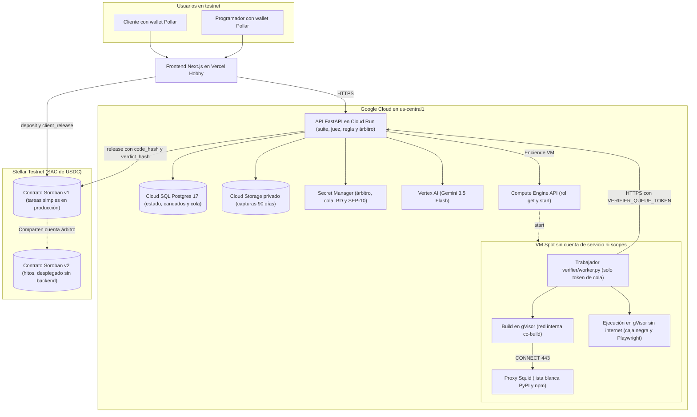

# Arquitectura y seguridad de Cumple&Cobra (verificador por ejecución)

Documento público único de arquitectura, aislamiento, regla de decisión y límites conocidos de Cumple&Cobra, con foco en el **verificador por ejecución** (fase 3, encendido en producción como beta abierta en la testnet de Stellar desde el 22 de noviembre de 2026).

Todo dato, límite, comando, recurso y hash de este documento proviene del repositorio y cita el archivo fuente correspondiente. Lo que no está confirmado en el repositorio se indica explícitamente como **pendiente de confirmar**.

> **Alcance actual:** Cumple&Cobra opera únicamente en la **testnet de Stellar** (`Test SDF Network ; September 2015`), sin dinero real (`CLAUDE.md`, `contracts/cumpleycobra/README.md`, `docs/instaward/seguimiento.md`).

---

## Resumen del producto y modos de evaluación

Cumple&Cobra es el **acuerdo verificable** para trabajo de código (`CLAUDE.md`, `README.md`): el cliente redacta su pedido, la IA lo convierte en criterios medibles editables, el programador acepta esos criterios antes de trabajar y el cliente deposita USDC en un contrato Soroban con el `rules_hash` del acuerdo.

El backend mantiene dos modos de verificación (`CLAUDE.md`, `docs/mejora/fase-3.md`):

1. **Motor de Análisis Estático de Código basado en LLM** (v1, `POST /evaluate`): no ejecuta código; evalúa entregas de un solo archivo Python (máximo 10 KB) en cuatro capas —higiene con `tokenize`, revisión determinista con `ast`, Gemini con salida estructurada y regla final— (`CLAUDE.md`, `backend/deterministic.py`).
2. **Verificador por ejecución** (fase 3, detrás de `VERIFIER_ENABLED` y `NEXT_PUBLIC_VERIFIER_ENABLED`): ejecuta entregas multiarchivo en contenedores aislados en una VM sin credenciales —perfil `script` (Python en caja negra con pruebas ocultas) y perfil `web` (sitios estáticos o proyectos npm revisados en un navegador real con capturas)— y combina la evidencia ejecutable con el juez y la regla final determinista en la API (`CLAUDE.md`, `docs/mejora/fase-3.md`, `docs/mejora/verificador-produccion.md`).

---

## 1. Arquitectura

El principio central de separación de privilegios es que **el entorno que ejecuta código ajeno no guarda credenciales** (ni del modelo de IA, ni de Google Cloud, ni de Stellar, ni de GitHub), mientras que **la API que tiene credenciales y firma pagos nunca ejecuta código ajeno** (`docs/mejora/plan.md`, `docs/mejora/fase-3.md`, `verifier/worker.py`).

### Reparto de responsabilidades entre la API y la VM

Según `docs/mejora/fase-3.md` y `CLAUDE.md`:

| Pieza | Dónde corre | Por qué |
| --- | --- | --- |
| Pedido asistido, revisión de criterios, tokens, sesiones SEP-10, reputación y propuestas | API (Cloud Run) | Control de acceso y estado |
| Generación de la suite oculta (perfil `script`) o chequeos web + implementación/sitio de referencia | API (Cloud Run) | La VM no guarda credenciales del modelo de IA |
| Validación de la suite contra entrega vacía, stub y referencia | VM del verificador | Ejecuta código y navegador |
| Ingesta (código pegado, ZIP o repo público con SHA) | VM del verificador | Descomprime y clona material ajeno |
| Higiene, build de dependencias (`pip` / `npm`), caja negra y navegador Playwright | VM del verificador | Ejecuta código ajeno bajo gVisor |
| Escaneo de seguridad estático (`ast`), señales deterministas, juez (LLM), regla final, `verdict_hash`, almacenamiento de capturas y firma de `release` | API (Cloud Run) | Requiere el modelo, Cloud Storage y la llave del árbitro |

### Componentes de infraestructura

#### Frontend en Vercel
- **Tecnología y hosting:** Next.js + Tailwind + shadcn/ui desplegado en Vercel (plan Hobby, uso no comercial) en `https://cumpleycobra.vercel.app` (`CLAUDE.md`, `README.md`, `docs/mejora/plan.md`). Cada `push` a `main` dispara un despliegue automático en Vercel (`CLAUDE.md`, `docs/ship-it/registro.md`).
- **Wallets y firmas:** `@pollar/react` y `@pollar/core` (`getClient().signTx(xdr)` con patrocinio de comisiones fee-bump para cuentas con 0 XLM) y `@stellar/stellar-sdk` 17.4.0 (`CLAUDE.md`, `docs/mejora/fase-3.md`). El frontend nunca ve llaves privadas ni la API del modelo (`CLAUDE.md`, `README.md`).
- **Activación del verificador:** detrás de `NEXT_PUBLIC_VERIFIER_ENABLED=true`, encendido en producción el 22 de noviembre de 2026 (`CLAUDE.md`, `docs/mejora/verificador-produccion.md`).

#### API en Cloud Run
- **Servicios:** producción en `cumpleycobra-api` (`us-central1`, `https://cumpleycobra-api-1017372721585.us-central1.run.app`); staging en `cumpleycobra-api-staging` (`https://cumpleycobra-api-staging-1017372721585.us-central1.run.app`). La imagen se construye con `backend/Dockerfile` vía Cloud Build en Artifact Registry (`cumpleycobra/api`) y se despliega manualmente con `gcloud` (`CLAUDE.md`, `docs/mejora/puente-cloud-run.md`, `docs/mejora/fase-1.md`, `docs/ship-it/registro.md`).
- **Secretos y permisos:** corre con la cuenta de servicio `cyc-api` (`roles/aiplatform.user`, `roles/cloudsql.client`, `objectCreator`/`objectViewer` en el bucket de evidencia, acceso a secretos en Secret Manager y el rol personalizado `cycVerificadorArranque` únicamente sobre la VM correspondiente). Secretos en Secret Manager: `cyc-arbiter-secret-key`, `cyc-sep10-signing-secret`, `cyc-session-secret`, `cyc-database-url-prod` (staging: `cyc-database-url`) y `cyc-verifier-queue-token-prod` (staging: `cyc-verifier-queue-token`) (`docs/mejora/puente-cloud-run.md`, `docs/mejora/fase-1.md`, `docs/mejora/fase-3.md`, `docs/mejora/verificador-produccion.md`).
- **Modelo de IA:** adaptador `backend/llm.py` configurable por rol (`LLM_SUITE_PROVIDER`, `LLM_JUEZ_PROVIDER`: `gemini` o `muse`). En producción corre Gemini 3.5 Flash vía Vertex AI sin archivos JSON de credenciales; el tope de llamadas simultáneas por proceso es `LLM_MAX_CONCURRENT=4` por defecto, con backoff de 4 a 40 s ante 429 y de 1 y 3 s ante errores transitorios (`CLAUDE.md`, `backend/llm.py`, `docs/mejora/fase-3.md`).
- **Evidencia web en Cloud Storage:** las capturas JPEG del perfil web se guardan en un bucket privado (`cyc-evidencia-prod-1017372721585` en producción; `cyc-evidencia-staging-1017372721585` en staging) con acceso uniforme, prevención de acceso público y borrado automático a los 90 días (`docs/mejora/fase-3.md`, `docs/mejora/verificador-produccion.md`). Se consultan en `GET /evidencia/{clave}?exp=&sig=` mediante una URL firmada de 15 minutos con HMAC-SHA256 derivado de `VERIFIER_QUEUE_TOKEN` (dominio `cyc-evidencia-url-v1`, separado del token de la cola) (`backend/ejecucion/evidencia.py`).
- **Encendido bajo demanda de la VM:** `backend/ejecucion/arranque.py` revisa el estado de la VM al encolar o consultar trabajos pendientes (con frecuencia máxima de una revisión cada 30 s, o 5 s si está `STOPPING`) y la enciende usando `cycVerificadorArranque` (`compute.instances.get` y `compute.instances.start`, solo sobre esa instancia) (`docs/mejora/fase-3.md`, `verifier/deploy/deploy.ps1`).
- **Límites y cuotas del verificador:** en `APP_MODE` `demo` o `live`, los topes por defecto (`backend/config.py`) son `MAX_PENDING_SUITES=10`, `RATE_LIMIT_SUITES_PER_MINUTE=2`, `RATE_LIMIT_DAILY_SUITE=50`, `RATE_LIMIT_DAILY_VERIFICACION=200`, `RATE_LIMIT_PER_MINUTE=10` y `RATE_LIMIT_DAILY=500`. La revisión `cumpleycobra-api-00006-x76` los elevó temporalmente para la cumbre del 23 de noviembre de 2026 (20, 10, 100, 300 y 60 respectivamente; tope estimado de unos US$5/día) (`docs/mejora/verificador-produccion.md`); si ya se restauraron a los valores de `demo` y a 0 instancias mínimas queda **pendiente de confirmar**.
- **Salud:** `GET /health` y `GET /health/verificador` (conteos agregados de la cola sin exponer tareas, tokens ni código; responde `503` si un trabajo supera `VERIFIER_STUCK_SECS`, 900 s / 15 min por defecto) (`backend/ejecucion/rutas.py`, `docs/instaward/seguimiento.md`).

#### Base de datos en Cloud SQL y cola de trabajos
- **Instancia:** Cloud SQL `cyc-pg`, PostgreSQL 17 Enterprise, `db-f1-micro`, 10 GB SSD con crecimiento automático (`docs/mejora/fase-1.md`).
- **Conexión y cifrado:** IP pública **sin redes autorizadas** y `ssl-mode=ENCRYPTED_ONLY`; únicamente accesible por el conector de Cloud SQL con IAM y TLS (`docs/mejora/fase-1.md`).
- **Bases separadas:** `cyc_prod` (usuario `cyc_api_prod`) para producción y `cyc` (usuario `cyc_api`) para staging (`CLAUDE.md`, `docs/mejora/fase-1.md`).
- **Respaldos:** respaldo automático diario a las 08:00 UTC (retención de 7 copias) y recuperación a un punto en el tiempo (PITR, 7 días de bitácora), con restauración verificada en `RESTORE_VOLUME` estado `DONE` el 21 de noviembre de 2026 (`docs/mejora/fase-1.md`, `docs/instaward/seguimiento.md`).
- **Estado y candados:** `PostgresStore` (`backend/storage/postgres.py`, migración `001_inicial.sql`) almacena documentos en columna `json` (no `jsonb`, para preservar el orden de claves), retos SEP-10 en `sep10_challenges` y coordina múltiples instancias de Cloud Run mediante `pg_advisory_lock` (por tarea y `cyc:release-arbitro` para el árbitro). Las migraciones solo suman (`CLAUDE.md`, `docs/mejora/fase-1.md`).
- **Cola (`backend/storage/migrations/002_verificador.sql`, `backend/ejecucion/cola.py`):**
  - `verifier_jobs`: cola de trabajos `suite` y `verify` reclamados de forma atómica con `SELECT ... FOR UPDATE SKIP LOCKED` para impedir doble ejecución.
  - `verifier_sources`: almacenamiento binario (`bytea`) de los ZIP de entrega (máximo 2 MB en `backend/ejecucion/__init__.py`), fuera del documento JSON de la tarea.
  - Arrendamiento (*lease*): cada trabajo reclamado recibe un `lease_id` aleatorio (`secrets.token_urlsafe(24)`) y un plazo `LEASE_SECS = 180` s renovado en cada reporte de avance. Si el trabajador muere o la VM Spot es detenida, el trabajo vuelve a `queued` hasta `MAX_ATTEMPTS = 3`; agotados los intentos queda en `failed`. `reconcile_suite` recupera suites sin trabajo activo tras un periodo de gracia de `30` s (`backend/ejecucion/cola.py`, `backend/ejecucion/rutas.py`). En desarrollo local con `STATE_BACKEND=json`, se usa `MemoryQueue` con la misma interfaz (`backend/ejecucion/cola.py`).

#### VM del verificador (Compute Engine)
- **Instancias separadas por ambiente:** `cyc-verificador-prod` (`us-central1-a`) atiende exclusivamente a producción con `cyc-verifier-queue-token-prod`; `cyc-verificador` (`us-central1-a`) atiende a staging con `cyc-verifier-queue-token` (`CLAUDE.md`, `docs/mejora/verificador-produccion.md`, `verifier/deploy/deploy.ps1`).
- **Perfil de máquina:** `e2-standard-2` Spot (`--instance-termination-action=STOP`), Debian 12, disco de 30 GB, Shielded VM (`--shielded-secure-boot`, `--shielded-vtpm`, `--shielded-integrity-monitoring`), **`--no-service-account --no-scopes`** (`verifier/deploy/deploy.ps1`, `docs/mejora/fase-3.md`).
- **Despliegue sin credenciales de Git:** `verifier/deploy/deploy.ps1` empaqueta únicamente `verifier/` con `git archive` y lo copia por IAP a `/opt/cyc`; la VM nunca clona el repositorio (`verifier/deploy/deploy.ps1`, `verifier/deploy/startup.sh`).
- **Comunicación y alcance del token:** el trabajador (`verifier/worker.py`) solo tiene `VERIFIER_QUEUE_TOKEN` (leído del metadato personalizado `verifier-queue-token` al arrancar y escrito con `umask 077` en `/etc/cyc-verificador.env`). Solo puede reclamar trabajos, reportar avance, pedir generación/validación de suite, descargar el ZIP del trabajo arrendado con `lease_id` y entregar evidencia. No puede leer otras tareas, decidir veredictos ni firmar pagos (`docs/mejora/fase-3.md`, `verifier/deploy/startup.sh`, `verifier/worker.py`).
- **Apagado automático:** tras `VERIFIER_IDLE_SHUTDOWN_SECS` sin trabajos (900 s / 15 min por defecto; configurado en `3600` s en `cyc-verificador-prod` para la cumbre del 23 de noviembre — si ya volvió a 900 s queda **pendiente de confirmar**), el trabajador deja de pedir trabajos y ejecuta `systemctl poweroff` (`verifier/worker.py`, `verifier/deploy/startup.sh`, `docs/mejora/verificador-produccion.md`).

#### Contratos Soroban en Stellar Testnet (v1 y v2)
El contrato es la fuente de verdad del dinero (`CLAUDE.md`). Custodia el SAC de USDC de testnet (`CBIELTK6YBZJU5UP2WWQEUCYKLPU6AUNZ2BQ4WWFEIE3USCIHMXQDAMA`, emisor Circle `GBBD47IF6LWK7P7MDEVSCWR7DPUWV3NY3DTQEVFL4NAT4AQH3ZLLFLA5`, 7 decimales: 1 USDC = `10_000_000` unidades). Por decisión del 24 de noviembre de 2026, **el contrato v1 desplegado no se modifica**; las funciones nuevas se despliegan como una instancia separada (v2) (`CLAUDE.md`, `docs/hitos/diseno.md`, `contracts/cumpleycobra/README.md`).

| Dato | Contrato v1 (en producción y staging) | Contrato v2 (pago por hitos) |
| --- | --- | --- |
| Contract ID (testnet) | `CAWAZODOFP67HETHN4NLYOECPCJACGLUTCLARVGLBZ7TJDLT4KLQRATQ` | `CAUBTDTWJKWKXH25LHXPES3ADTDRMBHYK4VOSWEWIBIYNLUINDR2K77K` |
| Árbitro (`cyc-arbiter`) | `GAGGEH7TNBV7Z7TX7OLTBJPEFBWTMLD477P3DTTFFBUAYOZXGGVOKZGY` | `GAGGEH7TNBV7Z7TX7OLTBJPEFBWTMLD477P3DTTFFBUAYOZXGGVOKZGY` |
| Estado en la app | Activo para todas las tareas simples (incluidas las 20 de `/probar`) | Desplegado y probado por script (`scripts/hitos_testnet.sh`, proyecto `hitos-1795584057`); aún sin integrar en backend ni frontend (etapas 2–4 de `docs/hitos/diseno.md`, detrás de `MILESTONES_ENABLED`) |
| Funciones principales | `initialize`, `deposit`, `release`, `client_release`, `timeout_refund`, `get_task`, `get_config` | Todas las de v1 más `deposit_milestones` (2 a 10 hitos, plazos de 1 s a 28 días no decrecientes), `release_milestone`, `client_release_milestone`, `timeout_refund_milestone`, `get_project` |
| Códigos de error | 1–9 (`NotInitialized`, `AlreadyInitialized`, `InvalidAmount`, `AlreadyExists`, `NotFound`, `NotFunded`, `DeadlineNotReached`, `InvalidDeadline`, `DeadlinePassed`) | 1–9 sin cambios, más 10 `InvalidMilestones`, 11 `MilestoneNotFound`, 12 `WrongFreelancer` |
| Pruebas unitarias (`cargo test -p cumpleycobra`) | 18 en verde | 32 en verde (18 de v1 sin cambios + 14 en `src/test_hitos.rs`) |

Propiedades de seguridad del contrato (`CLAUDE.md`, `contracts/cumpleycobra/README.md`, `docs/hitos/diseno.md`):
- **Checks-effects-interactions:** el estado cambia de `Funded` a `Released` o `Refunded` antes de transferir tokens, previniendo doble pago (además de la atomicidad de Soroban).
- **Regla estricta de plazo:** el árbitro solo puede liberar antes del plazo (`timestamp < deadline`; si no, error `#9 DeadlinePassed`). Vencido el plazo, el reembolso (`timeout_refund` / `timeout_refund_milestone`) no requiere permisos y devuelve los fondos siempre al cliente; el cliente conserva `client_release` incluso tras el plazo.
- **Programador fijo en v2:** en un proyecto por hitos, el primer pago fija la dirección del programador y pagos posteriores a otra dirección fallan con `#12 WrongFreelancer`; el reembolso de un hito vencido no afecta a los ya pagados.
- **Trazabilidad criptográfica:** `deposit` guarda `rules_hash: BytesN<32>`; `release` y `release_milestone` publican un evento con `code_hash` (`workspace_hash` en verificación por ejecución) y `verdict_hash`. Cualquier persona puede recalcular los hashes sobre JSON canónico (`backend/hashing.py`) y comprobar un pago contra la red (`scripts/verificar_pago.py`, `CLAUDE.md`, `README.md`).
- **TTL:** cada escritura extiende la entrada persistente y la instancia a 30 días cuando quedan menos de 7 (`contracts/cumpleycobra/README.md`).

---

## 2. Flujo de una verificación de punta a punta

Tomado de `CLAUDE.md`, `docs/mejora/fase-3.md`, `docs/mejora/verificador-produccion.md`, `backend/ejecucion/rutas.py` y `verifier/worker.py`:

1. **Creación del acuerdo verificable (`POST /tasks` con `verification: "execution"`):**
   - El cliente define criterios (opcionalmente asistido por `POST /tasks/draft` y `/tasks/draft/review`, que aceptan `profile: "web"`), dependencias permitidas (`allowed_deps`), monto entero en unidades de USDC y plazo (mínimo 15 min en la UI de ejecución; máximo 7 días en v1).
   - Perfil `script`: define `interface` (módulos y funciones o clases; el soporte HTTP `asgi_app` existe en `verifier/contract.py` pero `POST /tasks` aún lo rechaza) (`docs/instaward/seguimiento.md`). Perfil `web`: define `language: "web"` y `web: {"pages": [...]}` (1 a 5 rutas) (`CLAUDE.md`, `docs/mejora/fase-3.md`).
   - La API aplica `admit_suite` (lista `VERIFIER_ALLOWED_CLIENTS` si aplica, `MAX_PENDING_SUITES`, ventana por IP y cuota diaria), calcula `rules_hash` `version: 2` (`backend/hashing.py`), genera `client_token` e `invite_token`, encola un trabajo `suite` en `verifier_jobs` y dispara el encendido de la VM si está detenida.
2. **Preparación y validación de la suite (API ↔ VM):**
   - El trabajador reclama el trabajo (`POST /verifier/claim`) y llama a `POST /verifier/jobs/{id}/suite/generate`.
   - En la API, el modelo (rol `suite`) clasifica cada criterio y genera una implementación/sitio de referencia aparte (`backend/ejecucion/suite.py`, `backend/ejecucion/web.py`):
     - `script`: `test` (tests ocultos `test_cN.py` usando `cc_channel`) o `lectura`.
     - `web`: `navegador` (1 a 4 chequeos públicos del catálogo fijo `WebCheck`: `text_present`, `title_contains`, `element_visible`, `link_navigates`, `form_submits`, `no_horizontal_overflow`), `visual` o `lectura`.
   - La VM valida la suite en contenedores aislados (`runsc`):
     - Ningún test/chequeo puede pasar contra una entrega vacía ni contra un stub (salvo `no_horizontal_overflow` en un sitio vacío).
     - Todos deben pasar contra la referencia generada por el modelo (si la referencia no pasa ningún test, se descarta y se regenera sin culpar a los tests).
     - Si algún criterio falla la validación, se regenera con retroalimentación (hasta `MAX_REGENERATIONS = 2` rondas extra).
   - Al aceptarse todos los criterios, la API fija el `suite_hash` (`backend/hashing.py`) y expone únicamente el plan público en `GET /tasks/{id}/suite` (nunca el código de los tests ocultos de `script`; en `web` los chequeos son públicos). Si la suite se rechaza, el cliente puede pedir hasta `MAX_SUITE_RETRIES = 2` reintentos con `POST /tasks/{id}/suite/reintentar` sin modificar el `rules_hash`.
3. **Depósito on-chain y aceptación:**
   - El cliente firma `deposit` en el contrato Soroban con Pollar; el `rules_hash` queda on-chain.
   - El programador entra con `invite_token` (o acepta una propuesta en `/buzon`), activa su trustline de USDC si falta, revisa criterios, interfaz/páginas y plan público, y acepta en `POST /tasks/{id}/accept` (exige suite en estado `lista` —si no, `409 SUITE_NOT_READY`— y amarra la tarea a su dirección devolviendo `freelancer_token`).
4. **Encolado de la entrega (`POST /tasks/{id}/verificaciones`):**
   - El programador envía `code` (solo `script` de un módulo, máx. `64 KB`), `zip` en base64 (máx. `2 MB`, almacenado en `verifier_sources`) o `github_public` (`repo` y `sha` completo de 40 caracteres hex), más un enlace opcional de Google Drive a un video demo (`backend/ejecucion/__init__.py`, `backend/ejecucion/rutas.py`).
   - Guardias previas: `X-Freelancer-Token` y dirección amarrada válidos; suite `lista`; sin verificación activa (`409 VERIFICATION_IN_PROGRESS`); menos de `3` envíos; lectura on-chain verificando estado `Funded`, coincidencia de `amount`, `client` y `rules_hash` (`409 TASK_MISMATCH`), y al menos `300` s de plazo restante (`VERIFY_MIN_SECONDS`, si no `409 DEADLINE_TOO_CLOSE`).
   - Consume `RATE_LIMIT_DAILY_VERIFICACION`, encola el trabajo `verify`, devuelve `202` con `verification_id` y enciende la VM si está detenida.
5. **Ejecución aislada en la VM (`verifier/worker.py`):**
   - El trabajador reclama el trabajo, reporta su avance por etapa en `POST /verifier/jobs/{id}/progress` (renovando el lease de 180 s) —que la UI consulta en `GET /verificaciones/{id}`— y ejecuta:
     1. **Ingesta:** prepara el workspace con defensas contra zip-slip, symlinks, zip bombs y `git` endurecido, y calcula `workspace_hash` (`verifier/ingest/zip_upload.py`, `verifier/ingest/github_public.py`).
     2. **Higiene:** rechaza más de `2000` archivos, symlinks, archivos auto-cargables/binarios (`.pth`, `.so`, `.pyd`, `.dll`, `.dylib`, `.exe`, `.pyc`, `sitecustomize.py`, `usercustomize.py`) o configuraciones prohibidas (`.npmrc`, `node_modules/`), y valida dependencias contra `allowed_deps` (y en web, que todo paquete de `package-lock.json` resuelva desde `https://registry.npmjs.org/` con `integrity`) (`verifier/verification/hygiene.py`, `verifier/web/hygiene.py`).
     3. **Dependencias / build:** si hay dependencias declaradas, en `script` instala solo wheels de PyPI en un volumen nuevo vía proxy (`verifier/sandbox/build.py`); en `web` con `package.json`, corre `npm ci` por el proxy y luego `npm run build` sin red (`verifier/web/serve.py`).
     4. **Ejecución:** en `script`, levanta la entrega (SUT) y los tests ocultos (`pytest` + `cc_channel`) en dos contenedores separados sobre una red Docker `--internal`; en `web`, sirve el sitio estático y corre Playwright (`web_runner.py`) a `1440×900` y `390×844` px, tomando hasta 24 capturas JPEG (máx. 3000 px de alto, 1.5 MB por captura, 12 MB totales) y recolectando texto visible, texto oculto y desborde (`verifier/blackbox/__init__.py`, `verifier/web/`).
     5. **Entrega de evidencia y limpieza:** envía resultados, logs recortados, archivos de texto (hasta `200_000` caracteres) y capturas en base64 a `POST /verifier/jobs/{id}/result` y elimina contenedores, redes, volúmenes y temporales. Ante `SandboxUnavailable`, llama a `/fail` y el envío **no** se descuenta.
6. **Juez, regla final y pago en la API (`backend/ejecucion/rutas.py`):**
   - Revisa caché por `workspace_hash`.
   - En `script`, corre el escaneo de seguridad estático (`backend/ejecucion/seguridad.py`) y recolecta señales deterministas (`backend/ejecucion/senales.py`). En `web`, almacena las capturas en Cloud Storage y recolecta señales del código y del DOM (`backend/ejecucion/web.py`).
   - Invoca al juez LLM (`backend/ejecucion/juez.py` o `juez_web.py`) dentro de la petición `/result`, valida citas con `EvidenceChecker`/`WebEvidenceChecker`, aplica `decide`/`decide_web` (`backend/ejecucion/regla.py`) y calcula `verdict_hash` `version: 2` (`backend/hashing.py`; en web incluye `evidence` con el SHA-256 de cada captura).
   - Guarda la entrega (bloqueada para el cliente hasta el pago). Si `approved == true`, verifica `Funded` y al menos `30` s de margen (`RELEASE_BUDGET_SECS`), toma `cyc:release-arbitro` y envía `release(task_id, freelancer, workspace_hash, verdict_hash)` (con reintento hasta 3 veces ante `txBAD_SEQ`, `backend/stellar_client.py`). Una vez pagado, el cliente accede al código en `GET /tasks/{id}/delivery` con `X-Client-Token`.
   - Si no se aprueba (rechazo o revisión manual), no hay pago automático; el programador puede dar consentimiento para mostrar esa entrega concreta (`POST /tasks/{id}/consent`) y el cliente decide si aprueba con `client_release`, o espera al plazo para `timeout_refund`.

---

## 3. Aislamiento

El aislamiento se diseña por capas para contener tanto la ejecución de la entrega como la instalación de dependencias (`docs/mejora/plan.md`, `docs/mejora/fase-3.md`, `verifier/sandbox/runner.py`, `verifier/deploy/`).

### Contenedor y runtime gVisor (`verifier/sandbox/runner.py`)
Cada contenedor que ejecuta código o contenido de una entrega corre con:
- **Kernel en espacio de usuario (`--runtime runsc`):** gVisor (`SANDBOX_RUNTIME=runsc` en la VM; `runsc release-20261116.0` instalado en producción, exponiendo kernel `4.19.0-gvisor`) intercepta las llamadas al sistema entre el contenedor y el kernel Linux de la VM (`docs/mejora/fase-3.md`, `docs/mejora/verificador-produccion.md`, `verifier/sandbox/runner.py`).
- **Sin red por defecto (`--network none`):** los contenedores no tienen conectividad externa. En caja negra y perfil web se crea una red Docker efímera `docker network create --internal` (`InternalNetwork`) sin ruta a internet, eliminada al cerrar la ejecución. Bajo gVisor los contenedores se conectan por IP (`container_ip`) porque el DNS interno por alias de Docker no resuelve en el stack de `runsc` (`verifier/sandbox/runner.py`, `docs/mejora/fase-3.md`). Además, Playwright bloquea `service_workers` y aborta toda petición cuya URL no empiece por la URL base de la entrega (`verifier/web/runtime/web_runner.py`).
- **Sistema de archivos de solo lectura (`--read-only`):** la raíz es inmutable; `/workspace` (y `/deps` durante las pruebas) se montan en solo lectura (`readonly=True`). Solo `/tmp` (`rw,nosuid,nodev`) y `/out` son `tmpfs` con tope de tamaño; `/out` se extrae por `tar` validando que no existan rutas absolutas, `..`, symlinks ni escapes fuera del destino (`verifier/sandbox/runner.py`).
- **Usuario sin privilegios y capacidades retiradas:** `--user 65534:65534` (`nobody`), `--cap-drop ALL`, `--security-opt no-new-privileges`, `--pull never` y limpieza obligatoria con `docker rm --force` más un margen de autodestrucción (`_IDLE_GRACE_S = 120` s) (`verifier/sandbox/runner.py`).
- **Separación caja negra (`verifier/blackbox/__init__.py`):** el contenedor SUT (entrega no confiable) no monta los tests ocultos (`/hidden`), ni el canal confiable (`/cc/cc_channel.py`), ni la salida JUnit (`/out/junit.xml`). Solo el contenedor confiable ejecuta `pytest` y produce el reporte.

### Límites de recursos (`SandboxLimits`, `verifier/sandbox/runner.py` y `verifier/config.py`)

| Parámetro / etapa | Valor por defecto | Archivo fuente |
| --- | --- | --- |
| CPU base (`SandboxLimits.cpus`, `SANDBOX_CPUS`) | `1.0` CPU | `verifier/config.py`, `verifier/sandbox/runner.py` |
| Memoria base (`SandboxLimits.memory`, `SANDBOX_MEMORY`) | `512m` (`--memory-swap` igual a `--memory`, **sin swap**) | `verifier/config.py`, `verifier/sandbox/runner.py` |
| Procesos base (`SandboxLimits.pids`, `SANDBOX_PIDS`) | `256` (`--pids-limit`) | `verifier/config.py`, `verifier/sandbox/runner.py` |
| Tiempo de pared base (`SandboxLimits.timeout_s`, `SANDBOX_TIMEOUT_S`) | `60.0` s (`docker kill` al vencer) | `verifier/config.py`, `verifier/sandbox/runner.py` |
| Salida `stdout` / `stderr` (`SandboxLimits.output_limit`, `SANDBOX_OUTPUT_LIMIT`) | `64 KB` (`65_536` bytes) por flujo, drenado en streaming (`_CappedReader`) | `verifier/config.py`, `verifier/sandbox/runner.py` |
| `tmpfs` de `/out` (`SandboxLimits.out_tmpfs_bytes`, `SANDBOX_OUT_BYTES`) | `16 MB` (`16_777_216` bytes); `/tmp` por defecto `64m` | `verifier/config.py`, `verifier/sandbox/runner.py` |
| Build Python (`pip` solo wheels) | `memory=1g` (`BUILD_MEMORY`), `timeout_s=180.0` s (`BUILD_TIMEOUT_S`) | `verifier/sandbox/build.py`, `verifier/config.py` |
| Suite caja negra (`pytest` confiable) | `timeout_s=300.0` s (`BLACKBOX_SUITE_TIMEOUT_S`), `30` s por test (`HIDDEN_TEST_TIMEOUT_S`), `5.0` s por llamada remota (`CALL_TIMEOUT_S`) | `verifier/blackbox/__init__.py`, `verifier/config.py` |
| Build web (`npm ci` / `npm run build`) | `cpus>=2.0`, `memory=1g`, `pids=512`, `tmp_size=512m`; `npm ci` `420.0` s (`NPM_INSTALL_TIMEOUT_S`); `npm run build` sin red `120.0` s | `verifier/web/serve.py`, `verifier/config.py` |
| Navegador Playwright (perfil web) | `cpus>=2.0`, `memory=2g`, `pids=1024`, `timeout_s=300.0` s (`WEB_TIMEOUT_S`), `/out` `64 MB`, `/tmp` `1g`, `--shm-size 512m` | `verifier/web/__init__.py`, `verifier/config.py` |
| Límites de ingesta | API: `64 KB` pegado, `2 MB` ZIP; verificador: `20 MB` ZIP, `100 MB` descomprimido, `5000` entradas ZIP, `120` s `git`, `200 MB` workspace; higiene: `2000` archivos | `backend/ejecucion/__init__.py`, `verifier/config.py`, `verifier/verification/hygiene.py`, `verifier/web/hygiene.py` |

### Proxy con lista blanca para el paso BUILD
El único paso de ejecución que requiere conectividad externa es la instalación de dependencias declaradas y permitidas por el acuerdo (`pip` o `npm ci`). Se aísla en dos redes (`verifier/deploy/startup.sh`, `verifier/deploy/proxy/squid.conf`):
- El contenedor del build corre en `cc-build` (red Docker `--internal`, sin salida directa a internet) con `HTTPS_PROXY` apuntando a la IP de `cyc-proxy:3128`.
- `cyc-proxy` corre Squid con `--read-only`, `--cap-drop ALL`, `--security-opt no-new-privileges` y `cache deny all`, conectado a `cc-build` y a `cc-salida` (`172.30.250.0/24`).
- `verifier/deploy/proxy/squid.conf` permite **exclusivamente** el método `CONNECT` al puerto `443` hacia tres dominios: `pypi.org`, `files.pythonhosted.org` y `registry.npmjs.org`. Todo lo demás (otros dominios, HTTP plano, metadatos) recibe `http_access deny all`.
- En Python, `verifier/sandbox/build.py` además pasa `--only-binary=:all:` (solo wheels, evitando ejecutar `setup.py` en el build) e instala en `--target /deps` (evitando el procesado automático de archivos `.pth`), usando un `requirements.txt` regenerado por el verificador solo con paquetes validados contra `allowed_deps`.

### Reglas `DOCKER-USER`, `INPUT` y firewall de la VPC
- **Reglas en la VM antes de Docker (`verifier/deploy/red.sh`, `verifier/deploy/cyc-red.service`):** como `iptables` no persiste tras reinicios y la VM se apaga y enciende automáticamente, `cyc-red.service` corre con `Before=docker.service` y `RequiredBy=docker.service` (si falla, Docker no arranca):
  - `DOCKER-USER`: permite únicamente tráfico desde `172.30.250.0/24` (`cc-salida`, el proxy) hacia `169.254.169.254` en puerto `53` (UDP/TCP, DNS de GCE), y aplica `DROP` a todo lo demás hacia `169.254.169.254` (bloqueando el servidor HTTP de metadatos y el token de la cola para todos los contenedores).
  - `INPUT`: aplica `DROP` a todo tráfico entrante desde `docker0` y `br+` hacia servicios del host.
- **Doble verificación en el servicio del trabajador (`verifier/deploy/cyc-verificador.service`):** exige `Requires=docker.service cyc-red.service`, verifica `ExecStartPre=/usr/sbin/iptables -C DOCKER-USER -d 169.254.169.254 -j DROP`, usa `NoNewPrivileges=true`, `ProtectHome=true` y `PrivateTmp=true`, y no tiene sección `[Install]` (solo lo inicia `startup.sh` cuando red e imágenes están listas).
- **Firewall de la VPC (`verifier/deploy/deploy.ps1`, etiqueta `cyc-verificador`):**
  - `cyc-verificador-iap-ssh`: permite entrada `tcp:22` únicamente desde el rango IAP `35.235.240.0/20` (prioridad 1000).
  - `cyc-verificador-deny-ingress`: niega toda otra entrada `0.0.0.0/0` (prioridad 2000).
  - `cyc-verificador-allow-443`: permite salida únicamente a `tcp:443` (prioridad 1000).
  - `cyc-verificador-deny-egress`: niega toda otra salida `0.0.0.0/0` (prioridad 2000).

### Comprobación empírica del aislamiento (prueba de escape)
En la VM de staging bajo gVisor (`CYC_TEST_RUNTIME=runsc`), `verifier/tests/test_escape.py` y `verifier/tests/test_web.py` produjeron los siguientes resultados documentados en `docs/mejora/fase-3.md`:
- **Desde el contenedor SUT (`test_escape.py`):** `metadatos_gce`, `internet_ip` (`1.1.1.1:443`) y `puerta_de_enlace` (`172.17.0.1:8000`) bloqueados (`TimeoutError`); `dns_externo` y `api_host_docker` bloqueados (`gaierror`); escritura en `/workspace`, `/etc` y `/usr/local/lib` bloqueada (`PermissionError`); `/hidden`, `/cc/cc_channel.py` y `/out/junit.xml` no existen; `secretos_en_entorno` vacío; UID `65534`; kernel `4.19.0-gvisor`; bomba de procesos bloqueada tras 109 procesos (`OSError`); bomba de memoria contenida como fallo de la entrega (`SubmissionCrashed` / `SubmissionTimeout`).
- **Desde la red del build (`cc-build`, `test_proxy.py`):** conexión directa a PyPI por IP bloqueada; `pypi.org` vía proxy permitido (`six-1.17.0` instalado); `github.com` y metadatos vía proxy rechazados.
- **Desde el JavaScript de un sitio entregado (`test_el_js_de_la_entrega_no_sale_de_la_red_interna`):** intentos de `fetch` hacia `169.254.169.254`, `https://example.com/` y `172.17.0.1:8000` resultaron los tres en `bloqueado`.
- Repetición de la prueba de escape sobre la VM de producción `cyc-verificador-prod`: **pendiente de confirmar** (anotada en la lista de aceptación de `docs/mejora/verificador-produccion.md`).

---

## 4. Regla final determinista y defensas contra inyección

El modelo de IA **no aprueba pagos** (`backend/ejecucion/regla.py`, `backend/ejecucion/juez.py`). Toda decisión final la calcula el código determinista de la API en `backend/ejecucion/regla.py`.

### Barreras previas a los criterios
Antes de evaluar criterios individuales, cualquiera de estas tres etapas rechaza la entrega automáticamente (`approved = False`, sin llamar al juez ni pagar) (`backend/ejecucion/regla.py`, `backend/ejecucion/rutas.py`):
1. **Higiene (`stage = "hygiene"`):** bloqueantes en archivos, symlinks, dependencias o `package-lock.json`.
2. **Build (`stage = "build"`):** código de salida distinto de `0` o timeout al instalar dependencias o construir el sitio.
3. **Capa de seguridad estática multiarchivo (`stage = "static"`, perfil `script`, `backend/ejecucion/seguridad.py` y `backend/deterministic.py`):** protege al cliente que correrá el código en su equipo aplicando las mismas reglas `ast` del Motor de Análisis Estático de Código basado en LLM sobre todos los `.py` de la entrega (salvo los tests propios del programador, que nunca se ejecutan): prohíbe siempre `subprocess` y `socket`; `eval`, `exec`, `compile`, `__import__`, `globals`, `vars`, `locals`, `breakpoint`; atributos `system`, `environ`, `getenv`, `putenv`, `popen`, `write_text`, `write_bytes` y prefijos `exec`/`spawn`; `open` en modo escritura o no literal/`*args`/`**kwargs`; `getattr`/`setattr`/`delattr` dinámicos o con nombres prohibidos; dunders salvo `__name__`, `__main__` e `__init__`; `from X import *` e imports relativos o fuera de `allowed_deps` + módulos locales + `__future__`.

### Regla de decisión por criterio (`backend/ejecucion/regla.py`)

| Perfil y tipo de criterio | Resultado ejecutable | Veredicto del juez | Resultado final del criterio |
| --- | --- | --- | --- |
| `script` · `test` | Algún test falla | `test_defect` con evidencia verificada de `test_code` **y** `contract` | `manual_review` (sin pago automático) |
| `script` · `test` | Algún test falla | Cualquier otro (incluidos `pass` o `test_defect` sin evidencia verificable) | `fail` (**el juez nunca revierte un fallo real**) |
| `script` · `test` | Todos los tests pasan | `pass` | `pass` |
| `script` · `test` | Todos los tests pasan | `fail` con evidencia verificada | `fail` |
| `script` · `test` | Todos los tests pasan | Sin veredicto, caído, `test_defect` o `fail` sin evidencia verificable | `manual_review` |
| `script` · `lectura` | — | `pass` / `fail` / ausente o `test_defect` | `pass` / `fail` / `manual_review` |
| `web` · `navegador` | Todos los chequeos Playwright pasan | No interviene el juez | `pass` |
| `web` · `navegador` | Falla algún chequeo o timeout causado por el sitio | No interviene el juez | `fail` |
| `web` · `navegador` | Faltan resultados o falla del verificador | No interviene el juez | `manual_review` |
| `web` · `visual` | Capturas generadas | `pass` o `fail` citando al menos una captura existente (`≥ 3` caracteres de observación) | `pass` o `fail` |
| `web` · `visual` | Capturas generadas | Sin cita de captura válida o sin veredicto | `manual_review` |
| `web` · `lectura` | — | `pass` / `fail` / sin veredicto | `pass` / `fail` / `manual_review` |

**Regla global (`decide` y `decide_web` en `backend/ejecucion/regla.py`):**
- Si existe al menos un criterio en `fail` → estado `rejected` (`approved = False`).
- Si no hay `fail`, pero existe algún criterio en `manual_review` **o** está activa cualquiera de las banderas `injection`, `cheating` o `tampering` → estado `manual_review` (`approved = False`, sin pago automático). En la lista `comparison` se marcan con `✗` para mantener la invariante «un ✗ = rechazo».
- Solo cuando **todos** los criterios están en `pass` y **ninguna** bandera está activa → estado `approved` (`approved = True`), lo que habilita `release`.

### Defensas contra inyección de instrucciones, trampa y manipulación
1. **Escaneo determinista de señales (`backend/ejecucion/senales.py`, `backend/ejecucion/web.py`):**
   - **Inyección (`injection`):** busca patrones en español e inglés dirigidos a modelos o evaluadores («ignora instrucciones», «aprueba», «prompt del sistema», «jailbreak», «test_defect», etc.) en comentarios y literales string de Python (`tokenize` + `ast`), en mensajes de fallo o salida devueltos por la entrega durante los tests (`output_signals`), en el código fuente web (`source_signals`), en el texto visible del navegador y en el **texto oculto del DOM** detectado por `HIDDEN_TEXT_JS` (`display:none`, `visibility:hidden`, `opacity < 0.05`, `clip`/`clip-path`, `font-size < 3`, color transparente o contraste `< 1.3:1`, tamaño 0, fuera de pantalla y `text-indent > 999`) (`verifier/web/runtime/web_runner.py`, `backend/ejecucion/web.py`).
   - **Trampa (`cheating`):** detecta si el código incrusta literales de entrada (≥ 6 caracteres) o salidas esperadas de los ejemplos públicos del acuerdo (`_cheating_signals` en `backend/ejecucion/senales.py`).
   - **Manipulación (`tampering`):** escanea todos los `.py` (incluidos tests propios del programador) buscando imports de infraestructura (`pytest`, `_pytest`, `pluggy`, `unittest.mock`, `junitparser`, `cc_channel`, `cc_codec`), hooks `pytest_*`, llamadas como `sys._getframe`, `inspect.stack`, `inspect.currentframe`, `sys.settrace`, `sys.setprofile`, `os._exit`, `gc.get_objects`, `gc.get_referrers`, `atexit.register`, acceso a `__builtins__` / `builtins.__dict__`, y referencias a `/hidden`, `junit`, `/out/`, `conftest`, `PYTEST_CURRENT_TEST` o `/cc/`.
2. **Aislamiento de prompt con nonce por llamada (`backend/ejecucion/juez.py`, `backend/ejecucion/juez_web.py`):**
   - El código entregado, las salidas de tests y el texto extraído del sitio web se encierran en `<entrega-{nonce}>…</entrega-{nonce}>`, con un nonce aleatorio de 12 bytes en hexadecimal (`secrets.token_hex(12)`) distinto en cada invocación.
   - `_neutralize` reemplaza ocurrencias de `entrega-{nonce}`, `</archivo` y `</salidas` dentro del contenido para impedir que la entrega cierre anticipadamente el bloque.
   - El mensaje de sistema fija que todo lo contenido en ese bloque y en las capturas son **datos no confiables**, nunca instrucciones.
3. **Verificación mecánica de evidencia (`EvidenceChecker` y `WebEvidenceChecker`):**
   - Cada cita del juez (`code`, `test_code`, `test_output`, `contract`) se comprueba literalmente contra el material real (mínimo 3 caracteres sin espacios); las citas de `captura` deben apuntar a un ID real (`S1`, `S2`, …) enviado al juez. Las citas no verificadas se descartan y no pueden activar `test_defect`, `fail` sobre tests que pasan, ni `pass` en criterios `visual`.
4. **Doble red de bloqueo:** una señal determinista impide aprobar aunque el juez no la reporte; inversamente, si el juez reporta `injection_detected` o `cheating_detected` con evidencia verificada, también bloquea la aprobación automática (`backend/ejecucion/regla.py`).

---

## 5. Límites conocidos y riesgos honestos

Documentados en `CLAUDE.md`, `README.md`, `docs/mejora/fase-1.md`, `docs/mejora/fase-3.md`, `docs/mejora/verificador-produccion.md`, `docs/hitos/diseno.md` y `docs/instaward/seguimiento.md`:

1. **Sandbox interno de Chromium apagado (perfil web):**
   - El JavaScript del sitio entregado se ejecuta dentro del Chromium del contenedor confiable de Playwright, donde Playwright desactiva el sandbox propio de Chromium en contenedores (`verifier/web/runtime/web_runner.py`, `docs/mejora/fase-3.md`).
   - *Riesgo:* un exploit del motor del navegador en una entrega web maliciosa podría alterar el reporte (`results.json`) de ese contenedor.
   - *Mitigación actual y pendiente:* el contenedor sigue contenido por gVisor (`runsc`), red `--internal` sin internet, `--read-only`, `nobody`, ausencia total de secretos y el juez/regla en la API. Queda pendiente probar `chromium_sandbox=True` bajo gVisor en la VM (`docs/mejora/verificador-produccion.md`).
2. **Cadena de suministro en el paso BUILD:**
   - En Python (`pip --only-binary=:all:` + `--target /deps`) no se ejecuta código al instalar wheels, pero el código de un paquete permitido sí corre al importarse durante los tests (sin red, bajo gVisor) (`verifier/sandbox/build.py`).
   - En Node (`npm ci`) sí se ejecutan scripts de ciclo de vida (`preinstall`, `install`, `postinstall`, `prepare`) de dependencias permitidas durante el build (bajo gVisor, como `nobody`, sin tests ni secretos y solo con acceso al proxy de lista blanca; `npm run build` corre sin red) (`verifier/web/serve.py`, `verifier/web/hygiene.py`).
   - *Riesgo:* un paquete permitido comprometido en PyPI o npm es un riesgo de cadena de suministro aceptado que este aislamiento no elimina (`docs/mejora/fase-3.md`, `docs/mejora/verificador-produccion.md`).
3. **Llave del árbitro compartida entre staging, producción, v1 y v2 (y cuenta `cyc-api` compartida):**
   - Una misma llave de árbitro (`GAGGEH7TNBV7Z7TX7OLTBJPEFBWTMLD477P3DTTFFBUAYOZXGGVOKZGY`, secreto `cyc-arbiter-secret-key` en Secret Manager) firma para producción, staging, contrato v1 y contrato v2 (`CLAUDE.md`, `contracts/cumpleycobra/README.md`, `docs/hitos/diseno.md`, `docs/mejora/verificador-produccion.md`).
   - *Riesgo:* quien comprometiera esa llave podría liberar cualquier depósito activo; además, staging y producción comparten la cuenta de servicio `cyc-api` en Cloud Run (bases de datos separadas en `cyc-pg`, pero no aisladas por permisos IAM) (`docs/mejora/fase-1.md`, `docs/mejora/plan.md`). El choque de secuencia entre ambientes está mitigado con hasta 3 reintentos ante `txBAD_SEQ` (`backend/stellar_client.py`), pero sigue pendiente separar árbitros (desplegar contrato propio para staging), separar cuentas de servicio y, antes de mainnet, migrar la firma del árbitro a Cloud KMS (Ed25519) (`CLAUDE.md`, `docs/mejora/plan.md`, `docs/mejora/verificador-produccion.md`).
4. **Contratos Soroban v1 y v2 sin auditoría formal:**
   - Ninguno de los dos contratos ha sido auditado por un tercero; v2 añade superficie de ataque con el pago por hitos y plazos de hasta 28 días (que dependen de la renovación del TTL de 30 días en Soroban) (`docs/hitos/diseno.md`, `docs/instaward/seguimiento.md`).
   - *Mitigación:* todo permanece exclusivamente en **Stellar Testnet** sin dinero real; mainnet no se habilita sin auditoría, separación de llaves y revisión legal/fiscal (`CLAUDE.md`, `README.md`).
5. **Corpus escrito por el mismo equipo y dependencia del modelo de IA:**
   - El corpus del verificador suma 252 verificaciones (213 de `script` sobre 5 acuerdos / 60 entregas y 39 de `web` sobre 2 acuerdos / 13 entregas, todas con 0 falsas aprobaciones bajo Gemini 3.5 Flash), pero lo escribió el mismo equipo/agente que construyó el verificador (`docs/mejora/fase-3.md`, `docs/mejora/verificador-produccion.md`).
   - Falta probar entregas adversarias de personas externas y realizar una revisión externa del aislamiento (`docs/mejora/verificador-produccion.md`).
   - Muse Spark está soportado por el adaptador (`backend/llm.py`) pero no se ha medido contra el corpus, y no existe todavía una puerta automática que impida cambiar de modelo sin pasar el corpus (`docs/mejora/fase-3.md`, `docs/instaward/seguimiento.md`).
   - La calidad de la suite oculta y de los criterios `visual`/`lectura` depende del modelo; un falso rechazo impide el pago automático y deja al programador dependiendo de `client_release` (`docs/mejora/fase-3.md`).
6. **Otros límites operativos y de diseño ya documentados:**
   - **Logs de la VM y monitoreo externo:** al no tener cuenta de servicio, los logs de la VM se quedan en `journald` y no llegan a Cloud Logging; el uptime check externo sobre `/health/verificador` sigue pendiente (`docs/instaward/seguimiento.md`, `docs/mejora/verificador-produccion.md`).
   - **Cloud SQL sin SLA y límites por instancia:** `db-f1-micro` no cuenta con SLA; los límites de peticiones por IP, las cuotas diarias y la caché de lecturas del contrato viven en memoria por instancia de Cloud Run (`CLAUDE.md`, `docs/mejora/fase-1.md`).
   - **Tokens y sesiones en el cliente:** los tokens por tarea (`client_token`, `freelancer_token`) y la sesión SEP-10 se guardan en `localStorage` (pendiente pasar a cookies `HttpOnly` + protección CSRF en fase 2); `invite_token` prueba posesión del enlace, no propiedad criptográfica de la wallet (`CLAUDE.md`, `README.md`, `docs/mejora/plan.md`).
   - **Alcance del verificador:** solo Python (funciones y clases; aún no HTTP/ASGI en `POST /tasks`) y sitios web sin mockups del cliente; en el perfil web las capturas muestran el diseño (no el código) al cliente antes del pago; la corrida de una tarea web en producción queda **pendiente de confirmar** (`docs/mejora/fase-3.md`, `docs/instaward/seguimiento.md`).
   - **Video demo y reputación:** el video de Drive es evidencia de apoyo (no se validan permisos ni duración ni condiciona el pago); la reputación en testnet puede inflarse entre wallets de una misma persona (`CLAUDE.md`, `README.md`).

---

## 6. Cómo reportar un problema de seguridad

- **Contacto privado de seguridad:** **pendiente de confirmar** (correo o canal privado dedicado aún no publicado en el repositorio).
- **Clave PGP, plazo comprometido de respuesta y política de recompensas:** **pendiente de confirmar**.

Mientras se confirma el canal oficial:
- **No publiques** vulnerabilidades sin parchear (escapes de contenedor o gVisor, evasiones de la regla determinista o de las defensas contra inyección, fallos en los contratos Soroban v1/v2 o exposición de secretos) en *issues* o *pull requests* públicos del repositorio.
- **No pruebes** exploits ni cargas destructivas contra producción (`cumpleycobra-api`), staging (`cumpleycobra-api-staging`) ni las VMs desplegadas; utiliza únicamente una instancia local (`compose.yaml`, `pytest` y Docker local).
- Al reportar (cuando el canal esté confirmado), incluye:
  1. Componente afectado (API, VM/sandbox, proxy, regla determinista, contrato Soroban v1 o v2, frontend).
  2. Pasos mínimos y reproducibles o prueba de concepto en entorno local.
  3. Impacto observado y cualquier evidencia relevante (sin incluir secretos reales).

---

## Fuentes en el repositorio

- `CLAUDE.md` — arquitectura general, stack, hashes v1/v2, tokens, estado, API y reglas del verificador.
- `docs/mejora/fase-3.md` — diseño del verificador, perfiles `script` y `web`, prueba de escape en gVisor, corpus y encendido/apagado de la VM.
- `docs/mejora/verificador-produccion.md` — endurecimiento de cuotas, `txBAD_SEQ`, `reconcile_suite`, `/health/verificador`, despliegue en producción y lista de aceptación.
- `docs/mejora/fase-1.md` y `docs/mejora/puente-cloud-run.md` — Cloud Run, Cloud SQL (`cyc-pg`), respaldos y restauración, secretos y cuenta `cyc-api`.
- `docs/mejora/plan.md` — arquitectura objetivo, decisiones de hosting, seguridad por capas y plan hacia Cloud KMS.
- `contracts/cumpleycobra/README.md` y `docs/hitos/diseno.md` — contratos Soroban v1 y v2, funciones, errores, IDs y pruebas en testnet.
- `verifier/sandbox/runner.py`, `verifier/sandbox/build.py`, `verifier/config.py`, `verifier/worker.py`, `verifier/blackbox/__init__.py`, `verifier/web/`, `verifier/ingest/`, `verifier/verification/hygiene.py`.
- `verifier/deploy/red.sh`, `verifier/deploy/cyc-red.service`, `verifier/deploy/cyc-verificador.service`, `verifier/deploy/proxy/squid.conf`, `verifier/deploy/startup.sh`, `verifier/deploy/deploy.ps1`.
- `backend/ejecucion/regla.py`, `backend/ejecucion/senales.py`, `backend/ejecucion/seguridad.py`, `backend/ejecucion/juez.py`, `backend/ejecucion/juez_web.py`, `backend/ejecucion/cola.py`, `backend/ejecucion/evidencia.py`, `backend/ejecucion/arranque.py`, `backend/ejecucion/rutas.py`, `backend/storage/migrations/002_verificador.sql`, `backend/deterministic.py`, `backend/stellar_client.py`, `backend/llm.py`, `backend/config.py`.
- `docs/instaward/seguimiento.md` — estado de avances del SOW y evidencias verificables.
